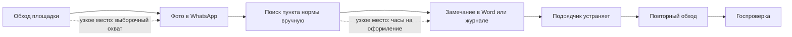

# Идея: помощник технадзора — от фото нарушения до указания со ссылкой на норму

Рабочее название — **Tekser** («проверь» по-казахски). Название, формулировки и цифры для слайдов команда придумывает и проверяет сама: в сдаче ИИ-контент запрещён (см. `research/01-rules.md`). Этот файл — гипотеза и её обоснование, а не текст питча.

## Статус после глубокого ресерча (11.11.2026)

Полный отчёт: [reports/Идеи ИИ MVP с реальным зазором.md](reports/Идеи%20ИИ%20MVP%20с%20реальным%20зазором.md). Проверено семь кандидатов и отброшено ещё тринадцать идей.

Главное: идеи, которая на проверенных данных проходит все пять условий (измеренная боль, нет конкурента, частный плательщик, ИИ в ядре, посильно команде), не найдено. Идея этого файла — помощник технадзора — в общем ранжировании третья.

| Место | Кандидат | Что подтверждено | Что не закрыто |
|---|---|---|---|
| 1 | Помощник по предписаниям пожарной и промышленной безопасности | За январь–июнь 2025: 15 996 проверок, более 105 тыс. нарушений, 7 957 приостановок работы (МЧС, первоисточник) | Конкурентов искали одним запросом; покупатель и цена не найдены |
| 2 | Экологический комплаенс для средних предприятий | За 10 месяцев 2025: 899 проверок, 2 540 нарушений, штрафы 5,47 млрд ₸ | Продукт MonitorPro не изучен; неизвестно, сколько штрафов приходится на средний бизнес |
| 3 | Помощник технадзора (этот файл) | Технадзор обязателен и оплачивается из проекта по закону | Что уже есть в E-Qurylys; число указаний и покупателей |
| 4 | Жалобы клиентов для МФО и коллекторов | 11 472 обращения к регулятору за ноябрь 2025 | Бюджета у покупателя не видно: штрафы 5 млн ₸ за месяц |
| 5–7 | Таможенные документы, заявки на субсидии, исполнительная документация | — | Государство заявило ту же функцию либо нет данных и эталона |

У трёх первых кандидатов общая механика: взять документ регулятора, найти норму с дословной цитатой, подготовить черновик ответа, который подписывает человек. Навыки команды подходят ко всем трём одинаково, поэтому выбор между ними делают интервью, а не код.

Ниже — описание третьего кандидата в том виде, в каком оно было до глубокого ресерча. Его не стоит считать выбранной идеей.

## Суть в трёх предложениях

Инженер технадзора фотографирует участок на телефон и отправляет фото с коротким комментарием в бот. ИИ привязывает нарушение к пункту действующей нормы, цитирует его дословно и собирает черновик письменного указания об устранении: фото, норма, срок, ответственный. Компания технадзора получает реестр указаний по всем своим объектам и видит, что устранено, а что нет.

Отрасль — строительство, одна из восьми приоритетных в программе.

## Кому продаём (уточнено после проверки закона и критики)

Первая версия идеи целилась в малых подрядчиков. Gemini справедливо возразил: подрядчику невыгодно находить у себя нарушения, бюджета на это у него нет. Проверка Строительного кодекса дала лучшего покупателя.

Строительный кодекс РК № 253-VIII от 09.01.2026, в силе с 01.07.2026 (прочитан по [zakon.uchet.kz](https://zakon.uchet.kz/rus/docs/K2600000253), сверить с [adilet.zan.kz](https://adilet.zan.kz/rus/docs/K2600000253)):

- Статья 54: технадзор обязателен на всех строительных объектах, кроме отдельных исключений, и оплачивается «за счёт средств, предусматриваемых проектом строительства». То есть строка бюджета существует по закону.
- Там же: лица, ведущие технадзор, вправе «выдавать письменные указания об обязательном устранении подрядчиком… нарушений государственных нормативных документов» и приостанавливать работы. Это и есть документ, который собирает наш продукт.
- Технадзор ведут аккредитованные юридические лица, в составе которых не менее трёх сертифицированных работников; за допущенные нарушения отвечает именно такое лицо.
- Статья 51: государственный контроль ведётся через автоматизированную цифровую систему, которая сама формирует уведомления о нарушениях.

Отсюда покупатель: **аккредитованные компании технадзора** и сертифицированные специалисты. Оформление указаний — их основная работа, ошибка в них грозит ответственностью, а деньги на технадзор заложены в каждом проекте. Подрядчики и застройщики — вторая очередь.

## Проверка новизны и размера проблемы (11.11.2026)

Коротко: идея актуальна, но не нова, и размер проблемы не доказан. Это рабочая гипотеза, а не найденная пустая ниша.

**Каждая часть идеи уже существует по отдельности.**

| Часть идеи | Кто уже делает | Статус |
|---|---|---|
| Нормы РК по пунктам с дословной цитатой, вопрос-ответ | **ARAI** ([arai.build](https://arai.build/ru/norms/kz)): 105 документов (СН РК, СП РК, правила), «более 100 000 пунктов норм РК», ответ с цитатой, бесплатно в браузере, есть казахский интерфейс. Продукт для архитекторов и генпланистов | Проверено по сайту |
| Замечания технадзора, электронные журналы, отчёт подрядчика об устранении, фотофиксация | Государственная **E-Qurylys**; по словам вице-министра, технадзоры уже работают в системе ([inform.kz](https://www.inform.kz/ru/tehnadzor-po-stroitel-stvu-budet-vestis-v-elektronnom-formate_a3811322), [cad.kz](https://cad.kz/about/news/edinaya-informatsionnaya-sistema-stroitelstva-respubliki-kazakhstan-e-qurylys)) | Сниппеты; точный состав функций не проверен |
| Фото с площадки → отчёт со ссылкой на пункт кодекса, инспектор подписывает | **Specta** ([specta.build](https://specta.build/)) — проверено по сайту; **Standa.ai** ([standa.ai](https://standa.ai/)) — по описанию в выдаче. Оба под нормы США | Частично проверено |
| Фото, замечания и предписания в мобильном приложении | Адепт: Стройконтроль, Exon, ЦУС, Project Point, Техзор, PlanRadar (работает в СНГ и пишет о Казахстане) | Сниппеты |
| ИИ-подбор норм по описанию и фото (нормы РФ) | СПРОСИ.НОРМУ, GOSTcheck | Сниппеты |
| Каски и жилеты по видео | AI Baqylau | Проверено по сайту |

**Чего я не нашёл:** продукта для казахстанского технадзора, который из фото и комментария делает указание со ссылкой на пункт нормы РК. Это узкий зазор между существующими продуктами, а не свободный рынок, и «не нашёл за несколько запросов» не значит «не существует». ARAI может закрыть его одной функцией.

**Что это ломает в первой версии идеи:**

- База норм с цитатами — не защита: она уже есть у ARAI и бесплатна.
- Свой реестр указаний, скорее всего, лишний: технадзор обязан вести замечания в E-Qurylys. Продукт должен готовить текст для неё, а не заменять её.
- Зато снят вопрос «где взять тексты норм»: ARAI ссылается на первоисточники, приказы об утверждении норм публикует adilet.zan.kz.

**Размер проблемы не доказан.**

- Что есть: на дорогах в 2026 году выявили 1 670 дефектов и нарушений, устранили 831; за ненадлежащий контроль уволили 22 эксперта технадзора, штрафы технадзору — 53,4 млн ₸ ([kt.kz](https://www.kt.kz/rus/state/22_eksperta_tehnadzora_uvolili_za_narusheniya_pri_dorozhnyh_1378000733.html), проверено). Это говорит, что технадзор пропускает нарушения и за это наказывают.
- Чего нет: ни одной цифры о том, сколько времени или денег технадзор теряет на оформлении указаний и поиске норм. Штрафы застройщикам на 1,59 млрд ₸ за год на всю страну — это около 3 млн долларов, не «огромная» сумма.
- Вывод: «огромная проблема» — пока моё предположение. Подтвердить или опровергнуть его могут только интервью.

**Что остаётся в пользу идеи:** покупатель с бюджетом по закону, приоритетная отрасль, понятный «почему сейчас». Для оценки на этапе не нужна уникальность — нужны обоснованное позиционирование и доказательства. Но доказательств пока нет.

## Два клина для одного покупателя

Критика GPT и Gemini (`research/04-second-opinions.md`) сошлась в том, что документная задача надёжнее фотоинспекции. У компании технадзора таких задач две:

| Клин | Что делает ИИ | Что нужно для MVP |
|---|---|---|
| 1. Указания о нарушениях (основной) | По фото и комментарию находит пункт нормы, цитирует, оформляет указание | Тексты норм, образцы указаний |
| 2. Проверка исполнительной документации по одному виду работ | Находит пропущенные документы и расхождения в датах, объёмах, марках материалов | 50–100 реальных пакетов документов |

Какой из двух отнимает больше времени и за какой заплатят, решают первые интервью. До них основной — первый: для него не нужны закрытые документы заказчика.

## Почему именно это

| Довод | На чём основан | Статус |
|---|---|---|
| Боль измерима в деньгах | Штрафы застройщикам 1,59 млрд ₸, 3 тыс.+ внеплановых проверок; 1463 нарушения в Астане и Алматы за 2025 | Сниппеты, перепроверить |
| Есть причина «почему сейчас» | Государство внедряет компьютерное зрение для контроля строек (3 дня → 4 часа) и утвердило план цифровизации отрасли на 2026–2027 | Проверено по zakon.kz |
| Спрос на ИИ в стройке подтверждён рынком | Armeta получила контракт Госэкспертизы; AI Qurylys продаёт платформу из шести модулей | Проверено по сайтам |
| Плательщик частный и с бюджетом | Технадзор обязателен и оплачивается из средств проекта (Строительный кодекс, ст. 54) | Проверено по тексту кодекса |
| Данные для старта открыты | Датасеты по каскам и жилетам есть. Тексты норм РК по пунктам собраны у ARAI со ссылками на первоисточники, приказы об утверждении норм публикует adilet.zan.kz. Какие редакции действуют и можно ли цитировать — проверить | Частично проверено |
| Навыки совпадают с тем, что уже делалось | Поиск с цитатами по нормативным документам, распознавание объектов на фото с телефона, боты в Telegram и WhatsApp на русском и казахском | Сужу по прошлым проектам на этой машине; состав команды из 5 человек мне неизвестен |

## Где здесь ИИ и почему без него не получится

Вопрос модуля 2.2: что становится возможным, а не просто быстрее.

Сегодня один инженер обходит площадку выборочно, фотографии уходят в чат WhatsApp, а пункт нормы для замечания он ищет по памяти или в PDF. С ИИ каждое фото, которое и так делается, превращается в проверенную запись со ссылкой на норму. Покрытие перестаёт зависеть от числа инженеров.

Что делает ИИ, по убыванию важности для MVP:

1. Поиск по нормам: по фото и комментарию инженера подбирает пункт документа и цитирует его дословно, на русском и казахском. Это ядро.
2. Генерация: собирает черновик письменного указания по шаблону.
3. Зрение: само находит на фото отсутствие каски и жилета. Для этого есть открытые датасеты (Ultralytics Construction-PPE — 1 416 фото, Mendeley PPE — 2 286 фото; лицензии проверить).

Чего MVP не делает и не обещает: автоматический поиск неограждённых проёмов, дефектов лесов и складирования — открытых датасетов под это не нашлось, и без понимания геометрии сцены будет много ложных срабатываний. Такие нарушения инженер называет сам, ИИ подбирает норму. Также вне MVP: скрытые и конструктивные дефекты, сверка с проектом и BIM. Подпись под документом остаётся за человеком.

## Процесс и узкое место (гипотеза до интервью)

Эту схему команда рисует заново по словам людей с площадки. Сейчас это моё предположение.

## Фильтр из шести критериев: три кандидата

Оценки 1–5 — моё суждение по найденным данным, не измерение.

| Критерий | A. Помощник технадзора | B. Тренажёр «виртуальный пациент» для медвузов | C. Болезни растений по фото |
|---|---|---|---|
| Приоритет для плательщика | 4 — технадзор отвечает за нарушения по закону | 2 — вуз покупает медленно | 3 |
| Измеримая рентабельность | 3 — часы инженера считаются, деньги пока нет | 2 — эффект на обучение трудно считать | 2 — ущерб в тенге не найден |
| Скорость выгоды | 5 — первое указание в первый день | 3 | 3 — сезонность |
| Внедрение пользователями | 4 — телефон и мессенджер уже в руках | 3 | 3 |
| Недовольство текущим | 3 — надо подтвердить интервью | 3 | 3 |
| Осуществимость через ИИ | 4 — поиск по нормам и документ да; зрение только для касок и жилетов | 4 | 3 — нет местных данных |
| Конкуренты | Сильные: Armeta, AI Qurylys, государство | В Казахстане не найдены, но поиск был один | Госпрограмма |
| Итог | **Основная** | Запасная | Отложить |

Про запасную идею B: на этой машине есть хакатонный проект медицинского симулятора с поиском по клиническим протоколам, то есть работающая основа уже существует. Минусы: по рынку найден один документ Медуниверситета Караганды про виртуальных пациентов и ни одной цифры боли; покупатель — вуз. Можно ли сдавать проект, начатый до этапа, надо спросить у координатора.

Кандидат на вторую запасную — проверка заявок фермеров на субсидии до подачи (сельское хозяйство, приоритетная отрасль; идею предложил Gemini). Единственная найденная цифра старая: Gosagro отклонила 22 444 заявки из 100 144 ([eldala.kz](https://eldala.kz/novosti/kazahstan/15104-gosagro-otklonila-bolee-22-tys-zayavok-na-subsidii), примерно 2023 год, сниппет). Свежей статистики отказов и их причин нет, поэтому пока без оценки.

Ещё две идеи я отбросил сразу. Распознавание полок в рознице — это рабочий продукт работодателя, и розница не входит в приоритетные отрасли. Казахоязычный бот продаж для малого бизнеса — вне приоритетных отраслей и слабо защищён.

## Конкуренты и наше место

| Кто | Что делает | Для кого | Чем отличаемся |
|---|---|---|---|
| ARAI | ИИ-агент для архитекторов: чертежи, расчёты, проверка по нормам РК с цитатой | Проектировщики | Самый опасный сосед: ядро у него уже есть. Мы — для технадзора на площадке, с готовым указанием. Различие тонкое |
| Armeta | Проверяет проектно-сметную документацию для Госэкспертизы | Государство, до начала стройки | Мы на площадке, во время стройки |
| AI Qurylys / AI Baqylau | Видеоаналитика с камер: СИЗ, опасные зоны, реестр инцидентов; ещё пять модулей | Владелец площадки | Работаем на технадзор, привязка к пункту нормы, готовое указание |
| Госконтроль с компьютерным зрением, E-Qurylys | Контроль сверху | Инспекция | Инструмент технадзора: он обязан находить нарушения раньше инспекции |
| ChatGPT и аналоги | Отвечает на вопросы | Все | Точная цитата нормы РК, реестр, шаблоны документов |
| WhatsApp и Word | Как сейчас | Все | Скорость и охват |

Главный риск: AI Qurylys или государственная система добавят то же самое. Ответ на него — узкий сегмент (компании технадзора, а не владельцы площадок), точность цитирования норм и накопленные данные. Довод «телефон вместо камер» сам по себе слабый: камеры дёшевы.

## Защита (moat)

- Данные: каждое подтверждённое или отклонённое инженером замечание — размеченный пример. Со временем получается местный датасет нарушений, которого нет в открытом доступе.
- База норм сама по себе защитой не является: у ARAI она уже есть. Защитой может стать только слой применимости — какой пункт относится к какому виду работ, высоте, стадии, с какими исключениями, — собранный вместе с действующими инженерами технадзора.
- Встроенность в работу: подготовка текста в том виде, в каком его принимает E-Qurylys. Свой реестр вместо государственного не предлагаем.

Честная оценка: защита слабая. Это главный недостаток идеи, и в слайде о конкурентах его придётся называть прямо.

## Что надо доказать, прежде чем строить

| Гипотеза | Как проверяем | Когда отказываемся |
|---|---|---|
| Оформление указаний и поиск норм отнимают у технадзора заметное время | 8–10 интервью: инженеры и руководители компаний технадзора, охрана труда, прорабы | Меньше половины подтверждают |
| Компании технадзора не пользуются AI Qurylys и аналогами для этой задачи | Те же интервью и вопрос «чем пользуетесь» | Уже пользуются и довольны |
| Кто-то готов платить | Просим письмо о намерении или пилот на объекте | Ни одного согласия на пилот |
| Поиск возвращает верный пункт нормы | Тест на 50 вопросах, ответы проверяет действующий инженер | Точность ниже порога из `PLAN.md` |
| Тексты норм можно законно получить и цитировать | Найти официальный источник и условия использования | Нет — тогда только номера пунктов без цитат, и ценность падает |
| Государственная цифровая система (ст. 51 кодекса) не закроет эту задачу сама | Вопрос на интервью, демо E-Qurylys | Закрывает бесплатно |

Если основная идея не проходит первые три проверки, переключаемся на запасную.

## Риски

- Ответственность: ИИ пропустил нарушение. Продукт — помощник, документ подписывает человек; это пишем прямо.
- Персональные данные: на фото люди. Размытие лиц до хранения, согласие в договоре.
- Закон об ИИ: вероятно, средний уровень риска и маркировка ИИ-контента в документах; уточнить по тексту закона.
- Зависимость от чужой модели зрения: закладываем замену модели и свой дообученный детектор.
