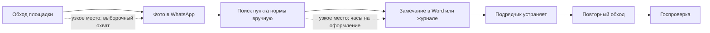

# Идея: предпроверка стройплощадки с телефона

Рабочее название — **Tekser** («проверь» по-казахски). Название, формулировки и цифры для слайдов команда придумывает и проверяет сама: в сдаче ИИ-контент запрещён (см. `research/01-rules.md`). Этот файл — гипотеза и её обоснование, а не текст питча.

## Суть в трёх предложениях

Инженер технадзора, специалист по охране труда или прораб фотографирует участок на телефон и отправляет фото в бот. ИИ находит видимые нарушения, привязывает каждое к пункту действующей нормы и собирает черновик замечания с фото, сроком устранения и ответственным. Подрядчик видит реестр замечаний и готовность объекта до того, как придёт государственная проверка.

Отрасль — строительство, одна из восьми приоритетных в программе.

## Почему именно это

| Довод | На чём основан | Статус |
|---|---|---|
| Боль измерима в деньгах | Штрафы застройщикам 1,59 млрд ₸, 3 тыс.+ внеплановых проверок; 1463 нарушения в Астане и Алматы за 2025 | Сниппеты, перепроверить |
| Есть причина «почему сейчас» | Государство внедряет компьютерное зрение для контроля строек (3 дня → 4 часа) и утвердило план цифровизации отрасли на 2026–2027 | Проверено по zakon.kz |
| Спрос на ИИ в стройке подтверждён рынком | Armeta получила контракт Госэкспертизы; AI Qurylys продаёт платформу из шести модулей | Проверено по сайтам |
| Плательщик частный | Подрядчик и застройщик платят штрафы и переделки сами | Логика, подтвердить интервью |
| Данные для старта открыты | Нормы публикуются; есть открытые датасеты по каскам, жилетам и стройплощадкам | Наличие и лицензии проверить |
| Навыки совпадают с тем, что уже делалось | Поиск с цитатами по нормативным документам, распознавание объектов на фото с телефона, боты в Telegram и WhatsApp на русском и казахском | Сужу по прошлым проектам на этой машине; состав команды из 5 человек мне неизвестен |

## Где здесь ИИ и почему без него не получится

Вопрос модуля 2.2: что становится возможным, а не просто быстрее.

Сегодня один инженер обходит площадку выборочно, фотографии уходят в чат WhatsApp, а пункт нормы для замечания он ищет по памяти или в PDF. С ИИ каждое фото, которое и так делается, превращается в проверенную запись со ссылкой на норму. Покрытие перестаёт зависеть от числа инженеров.

Что делает ИИ:

1. Зрение: находит на фото видимые нарушения — отсутствие каски, жилета или страховки на высоте, неограждённые проёмы и перепады, состояние лесов, складирование.
2. Поиск по нормам: подбирает пункт документа и цитирует его дословно, на русском и казахском.
3. Генерация: собирает черновик замечания или предписания по шаблону.

Чего MVP не делает и не обещает: скрытые и конструктивные дефекты (армирование, бетон, геометрия), сверку с проектом и BIM. Подпись под документом остаётся за человеком.

## Процесс и узкое место (гипотеза до интервью)

Эту схему команда рисует заново по словам людей с площадки. Сейчас это моё предположение.

## Фильтр из шести критериев: три кандидата

Оценки 1–5 — моё суждение по найденным данным, не измерение.

| Критерий | A. Предпроверка стройки | B. Тренажёр «виртуальный пациент» для медвузов | C. Болезни растений по фото |
|---|---|---|---|
| Приоритет для плательщика | 4 — штрафы и остановка работ | 2 — вуз покупает медленно | 3 |
| Измеримая рентабельность | 4 — штрафы, переделки, часы инженера | 2 — эффект на обучение трудно считать | 2 — ущерб в тенге не найден |
| Скорость выгоды | 5 — первое фото в первый день | 3 | 3 — сезонность |
| Внедрение пользователями | 4 — телефон и мессенджер уже в руках | 3 | 3 |
| Недовольство текущим | 3 — надо подтвердить интервью | 3 | 3 |
| Осуществимость через ИИ | 3 — видимые нарушения да, остальное нет | 4 | 3 — нет местных данных |
| Конкуренты | Сильные: Armeta, AI Qurylys, государство | В Казахстане не найдены, но поиск был один | Госпрограмма |
| Итог | **Основная** | Запасная | Отложить |

Про запасную идею B: на этой машине есть хакатонный проект медицинского симулятора с поиском по клиническим протоколам, то есть работающая основа уже существует. Минусы: по рынку найден один документ Медуниверситета Караганды про виртуальных пациентов и ни одной цифры боли; покупатель — вуз. Можно ли сдавать проект, начатый до этапа, надо спросить у координатора.

Ещё две идеи я отбросил сразу. Распознавание полок в рознице — это рабочий продукт работодателя, и розница не входит в приоритетные отрасли. Казахоязычный бот продаж для малого бизнеса — вне приоритетных отраслей и слабо защищён.

## Конкуренты и наше место

| Кто | Что делает | Для кого | Чем отличаемся |
|---|---|---|---|
| Armeta | Проверяет проектно-сметную документацию для Госэкспертизы | Государство, до начала стройки | Мы на площадке, во время стройки |
| AI Qurylys / AI Baqylau | Видеоаналитика с камер: СИЗ, опасные зоны, реестр инцидентов; ещё пять модулей | Объекты, где ставят камеры | Телефон вместо камер, привязка к пункту нормы, готовый документ |
| Госконтроль с компьютерным зрением, E-Qurylys | Контроль сверху | Инспекция | Инструмент подрядчика для самопроверки до инспекции |
| ChatGPT и аналоги | Отвечает на вопросы | Все | Точная цитата нормы РК, реестр, шаблоны документов |
| WhatsApp и Word | Как сейчас | Все | Скорость и охват |

Главный риск: AI Qurylys добавит режим съёмки с телефона. Ответ на него — узкий сегмент (малые и средние подрядчики, которым камеры не по карману) и накопленные данные.

## Защита (moat)

- Данные: каждое подтверждённое или отклонённое инженером замечание — размеченный пример. Со временем получается местный датасет нарушений, которого нет в открытом доступе.
- Нормы: корпус строительных норм РК, разобранный до пунктов, на двух языках.
- Встроенность в работу: реестр замечаний и история объекта, которые жалко бросать.

## Что надо доказать, прежде чем строить

| Гипотеза | Как проверяем | Когда отказываемся |
|---|---|---|
| Оформление замечаний и поиск норм отнимают заметное время | 8–10 интервью: технадзор, охрана труда, прорабы | Меньше половины подтверждают |
| Малые и средние подрядчики не пользуются AI Qurylys и аналогами | Те же интервью и вопрос «чем пользуетесь» | Уже пользуются и довольны |
| Кто-то готов платить | Просим письмо о намерении или пилот на объекте | Ни одного согласия на пилот |
| ИИ видит нарушения на местных фото | Тест на 100–200 реальных фото | Точность ниже порога из `PLAN.md` |
| Тексты норм можно законно использовать | Проверка источников и лицензий | Нет — тогда только ссылки на пункты без цитат |

Если основная идея не проходит первые три проверки, переключаемся на запасную.

## Риски

- Ответственность: ИИ пропустил нарушение. Продукт — помощник, документ подписывает человек; это пишем прямо.
- Персональные данные: на фото люди. Размытие лиц до хранения, согласие в договоре.
- Закон об ИИ: вероятно, средний уровень риска и маркировка ИИ-контента в документах; уточнить по тексту закона.
- Зависимость от чужой модели зрения: закладываем замену модели и свой дообученный детектор.
