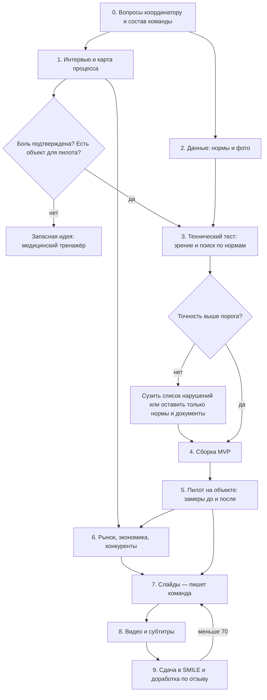
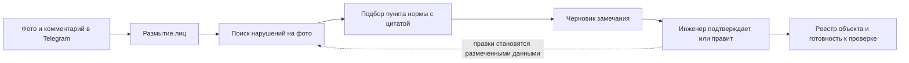

# План: что делаем и как

Идея и её обоснование — в `IDEA.md`. Правила — в `research/01-rules.md`. Здесь порядок работы: этапы, зависимости, кто что делает, по каким признакам идём дальше или сворачиваем.

Ничего из этого ещё не сделано: продукт не начат, интервью не проведены.

## Сначала — четыре вопроса координатору

От ответов зависит, как вообще строить работу, поэтому они идут до всего остального.

1. Где граница запрета на ИИ: можно ли писать код MVP с ИИ-ассистентом, делать субтитры автопереводом, пользоваться ИИ для поиска источников?
2. Дедлайн сдачи и точные веса двенадцати этапов (они есть в 33-минутном инструктаже Пола Кима на платформе).
3. Можно ли развивать проект, начатый раньше (нужно для запасной идеи).
4. На каком языке слайды; что значит «≈60% за MVP» на слайде 20 при весе этапа 03 в 15 баллов из 120.

## Граф работ

Этапы 1 и 2 идут параллельно. Этап 6 можно начинать сразу после интервью, не дожидаясь пилота.

## Этапы

### 0. Команда и правила

- Собрать пятерых и раздать роли (ниже).
- Задать четыре вопроса координатору.
- Посмотреть инструктаж по финальному проекту и выписать критерии каждого этапа питча.

### 1. Интервью и карта процесса

- 8–10 разговоров: инженеры технадзора, специалисты по охране труда, прорабы, руководитель небольшой подрядной компании.
- Что выясняем: как сейчас фиксируют нарушения; сколько времени уходит на оформление; какие нормы ищут чаще всего; сколько штрафов и переделок было за год; чем пользуются; кто принимает решение о покупке.
- Просим: 100–200 реальных фото с площадок, образцы замечаний и предписаний, согласие на пилот.
- Результат: карта процесса с узким местом и замерами времени, цитаты, один-два объекта для пилота.
- Условие перехода: больше половины подтверждают боль и есть хотя бы один объект. Иначе — запасная идея.

### 2. Данные

- Нормы: составить список документов по безопасности труда в строительстве и организации площадки, найти официальные источники, проверить, можно ли законно хранить и цитировать тексты. Разобрать до пунктов с номерами, на русском и казахском.
- Фото: открытые датасеты по каскам, жилетам и стройплощадкам (проверить существование и лицензии) плюс фото от интервью. Лица размывать до хранения.
- Проверочный набор, который не участвует в настройке: 50 вопросов по нормам с правильным пунктом; 100 фото, размеченных инженером.

### 3. Технический тест

Цель — узнать, что реально работает, до того как строить интерфейс.

- Зрение: сравнить готовый детектор, дообученный на открытых данных, и мультимодальную LLM на одних и тех же 100 фото.
- Поиск по нормам: проверить, что система возвращает верный пункт и цитирует его дословно.
- Пороги (предварительные, уточнить после интервью): верный пункт нормы в первых трёх результатах — не реже 85%; цитата совпадает с текстом нормы — 100%, иначе ответ не показываем; по нарушениям, которые берём в MVP, — не больше одного ложного замечания на пять и не меньше 70% найденных.
- Если зрение не проходит: сокращаем список типов нарушений до тех, что проходят, либо инженер сам называет нарушение голосом или текстом, а ИИ подбирает норму и оформляет документ.

### 4. Сборка MVP

- Вход — бот в Telegram: у команды уже был опыт с ботами, и ставить приложение на площадке никто не будет.
- Кабинет в браузере: реестр замечаний, статусы, выгрузка документа.
- Обязательное: каждое замечание показывает фото, пункт нормы с дословной цитатой и уверенность; без подтверждения человека документ не формируется.
- Не делаем в MVP: сверку с проектом, интеграцию с E-Qurylys, работу без сети.

### 5. Пилот

- Один-два объекта, одна-две недели.
- Замеряем до и после: минуты на оформление одного замечания; число замечаний за обход; долю замечаний ИИ, принятых инженером; число устранённых в срок.
- Это даёт материал сразу для четырёх этапов питча: решение, ценность, тяга, команда.

### 6. Рынок, экономика, конкуренты

- Рынок: число действующих строительных компаний и объектов (Бюро нацстатистики), число аттестованных инженеров технадзора (реестр министерства) — эти цифры ещё не найдены.
- Экономика: цена за объект в месяц — по ответам из интервью; себестоимость одной проверки фото — замерить на этапе 3; сколько стоит привлечь клиента — по первым продажам. Цифры считаем, а не придумываем.
- Конкуренты: запросить демо AI Qurylys, посмотреть сессию Санжара Рахметжанова (Armeta) в модуле 2.2.
- Запрос на финансирование: условия AI'preneurs и грантов QazInnovations.

### 7–9. Слайды, видео, сдача

- Слайды пишет команда сама, своими словами, по своим заметкам с интервью и пилота. Файлы этого репозитория в слайды не копируются.
- Видео: не меньше трёх минут, все пятеро в кадре, английские субтитры; в кадре — живая демонстрация бота на реальном фото.
- Доступ по ссылке на слайды и видео проверить из окна инкогнито.
- После первой сдачи читаем разбор по этапам и правим слабые. Попытки не ограничены.

## Какой этап питча чем закрываем

| Этап питча | Что нужно показать | Откуда берём |
|---|---|---|
| 01 Проблема | Процесс, узкое место, потери в деньгах | Интервью, перепроверенная статистика штрафов |
| 02 Рынок | Сегмент: малые и средние подрядчики; расчёт числа объектов | Этап 6 |
| 03 Решение / MVP | Работающий бот, схема, метрики точности | Этапы 3–5 |
| 04 Ценность | Минуты и замечания до и после | Пилот |
| 05 Бизнес-модель | Цена, себестоимость проверки | Этапы 3 и 6 |
| 06 Конкуренты | Таблица из `IDEA.md`, дополненная после демо | Этап 6 |
| 07 Выход на рынок | Первые клиенты через технадзор и отраслевые чаты | Интервью |
| 08 Финансы | Простая модель роста от числа объектов | Этап 6 |
| 09 Команда | Роли, чего не хватает (отраслевой советник) | Этап 0 |
| 10 Тяга | Пилот, письма о намерении | Пилот |
| 11 Финансирование | Сумма под конкретные шаги | Этап 6 |
| 12 Видение | Все виды контроля на площадке, затем Узбекистан и соседи | Обсуждение команды |

## Роли на пятерых

| Роль | Отвечает за |
|---|---|
| Продукт и интервью | Разговоры с площадкой, карта процесса, пилот |
| Зрение | Датасеты, детектор, проверочный набор фото |
| Нормы и поиск | Корпус норм, цитирование, проверочный набор вопросов |
| Бот и кабинет | Telegram, реестр, документы |
| Бизнес и питч | Рынок, экономика, конкуренты, сборка слайдов и видео |

Слайды и видео делают все: каждый пишет свою часть.

## Готово, когда

- Бот принимает фото и возвращает замечание с цитатой нормы; точность измерена на отложенном наборе.
- Есть хотя бы один объект, где им пользовались, и замеры до и после.
- У каждой цифры в слайдах есть источник, который кто-то из команды открыл сам.
- Слайды и видео сделаны без ИИ-текста, доступ по ссылке работает, оценка в SMILE не ниже 70.
